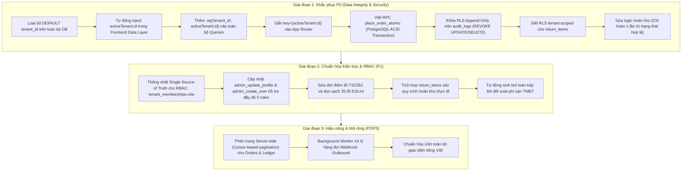

# ANTIGRAVITY BASELINE AUDIT — NEXUSOMS V3
**Auditor:** Principal Software Architect & Senior Full-Stack Engineer (Antigravity Agent)  
**Date:** 2026-10-28  
**Repository:** https://github.com/ThanhBinhDuongNguyen/Noxus-V3  
**Status:** COMPLETE (Read-Only Baseline Audit — No Production Mutations Performed)

---

## 1. Executive Summary

Báo cáo kiểm toán này đánh giá toàn diện mã nguồn, cơ sở dữ liệu Supabase (Migrations, RPC, RLS), cơ chế xác thực (`AuthProvider`), phân quyền (RBAC), cách ly dữ liệu Multi-Tenant và các luồng nghiệp vụ cốt lõi của **NexusOMS V3** sau khi chuyển giao từ môi trường Bolt sang Antigravity.

### Kết quả Tổng quan:
- **Build & Compiling:** 
  - `vite build`: Hoàn thành (do esbuild bỏ qua typecheck chặt chẽ khi bundle).
  - `npm run typecheck` (`tsc --noEmit`): **FAILED** (Lỗi `TS2352` tại `src/pages/DashboardPage.tsx:103`).
  - `npm run lint` (`eslint .`): **FAILED** (35 problems: 29 errors, 6 warnings).
- **Kết nối Supabase:** Đã xác minh kết nối đến Supabase Project Ref `omedrlhbvgbhjysluvwr` (URL: `https://omedrlhbvgbhjysluvwr.supabase.co`). Không có thông tin secret/service-role nào bị lộ.
- **Multi-Tenant Context:** Đã khắc phục một phần ở V3 trên các RPC báo cáo (`p_tenant_id`), **nhưng tồn tại lỗ hổng nghiêm trọng ở tầng INSERT và SELECT frontend**: toàn bộ business tables đang mang giá trị `DEFAULT` của Tenant mặc định và các màn hình frontend không truyền `tenant_id`, dẫn đến nguy cơ ghi đè hoặc rò rỉ dữ liệu chéo giữa các workspace.
- **Tính toàn vẹn nghiệp vụ:** Luồng tạo đơn hàng, trừ tồn kho, hoàn kho và ghi sổ kế toán đang được thực thi phân mảnh ở client-side bằng các vòng lặp JavaScript không có Transaction bảo bọc, tiềm ẩn rủi ro sai lệch số lượng tồn kho và dữ liệu tài chính.

---

## 2. Ma trận Phân loại Vấn đề (P0 - P3)

| ID | Mức độ | Phân hệ | Vấn đề phát hiện | Rủi ro |
| :--- | :--- | :--- | :--- | :--- |
| **P0-1** | **P0 (Critical)** | Multi-Tenancy / DB | Giá trị `tenant_id DEFAULT` cố định ở 25+ business tables kết hợp frontend không gửi `tenant_id` | Tạo dữ liệu ở Tenant B bị ghi nhận nhầm vào Tenant A hoặc lỗi RLS 42501 |
| **P0-2** | **P0 (Critical)** | Frontend Queries | Các truy vấn nghiệp vụ (Orders, Customers, Products, Warehouses...) thiếu điều kiện `.eq('tenant_id', activeTenant.id)` | User có membership ở nhiều tenant sẽ thấy dữ liệu của tất cả tenant trộn lẫn |
| **P0-3** | **P0 (Critical)** | State / UX | Chuyển workspace (`switchTenant`) không kích hoạt re-fetch dữ liệu trên các trang đang mở | Hiển thị và thao tác trên dữ liệu cũ của workspace trước đó |
| **P0-4** | **P0 (Critical)** | Inventory / Orders | Đặt hàng không atomic: Order INSERT trước, sau đó lặp client-side gọi `decrement_stock` | Khi sản phẩm thứ 2 hết hàng, đơn hàng vẫn được lưu, sản phẩm 1 đã bị trừ kho (inconsistent state) |
| **P0-5** | **P0 (Critical)** | Security / RLS | Bảng `return_items` được tạo ở migration V3 với chính sách `USING (true)` | Rò rỉ dữ liệu đổi trả hàng giữa các tenant |
| **P0-6** | **P0 (Critical)** | Audit / Security | Bảng `audit_logs` cấp quyền `UPDATE` và `DELETE` cho role `authenticated` | Vi phạm tính bất biến (immutability) của nhật ký kiểm toán SHA-256 |
| **P0-7** | **P0 (Critical)** | Inventory Logic | Lỗi nhân đôi tồn kho khi hủy đơn hoặc xóa đơn | Hủy đơn đã phục hồi tồn, nếu chuyển tiếp sang `refunded` hoặc bấm xóa đơn sẽ gọi `restore_stock` thêm lần nữa |
| **P1-1** | **P1 (High)** | Build / TS | `tsc --noEmit` thất bại tại `DashboardPage.tsx:103` (`error TS2352`) | Không thể tích hợp CI/CD chuẩn |
| **P1-2** | **P1 (High)** | Code Quality | ESLint thất bại với 29 errors (unused variables, hooks missing dependencies) | Code smell, nguy cơ memory leak và stale closure trong React Hooks |
| **P1-3** | **P1 (High)** | RBAC | Lệch pha giữa `profiles.role` và `tenant_memberships.role`; gán nhầm vai trò `manager` | Admin sửa quyền trong Settings chỉ đổi `profiles.role` toàn cục, không đổi quyền trong Tenant; `manager` bị map về `warehouse` |
| **P1-4** | **P1 (High)** | Returns / RMA | Quản lý đổi trả chưa liên kết hoàn kho (`return_items` không được dùng, không gọi `restore_stock`) | Hàng trả về kho không được cộng lại vào tồn khả dụng |
| **P1-5** | **P1 (High)** | Finance | Đối soát phí TMĐT (`FeeReconciliationPage`) không sinh bút toán Sổ kép (`journal_entries`) | Báo cáo tài chính và sổ cái không đồng nhất |
| **P1-6** | **P1 (High)** | Ledger | Tạo bút toán Sổ cái từ client-side không có ràng buộc cân đối tổng Nợ == tổng Có | Nguy cơ tạo bút toán lệch Nợ/Có khi mạng chập chờn |
| **P2-1** | **P2 (Medium)** | Performance | Các truy vấn fetch danh sách lớn không có server-side pagination | Tràn RAM client và lag mạng khi lượng đơn đạt hàng chục ngàn |
| **P2-2** | **P2 (Medium)** | Integrations | Webhook outbound chưa có background worker tự động dispatch | Chỉ lưu bảng log mà chưa có cơ chế retry queue nền |
| **P2-3** | **P2 (Medium)** | Chaos Simulator | Kịch bản Simulator chưa phản ánh đầy đủ logic thật (Flash sale không trừ kho, Webhook thiếu idempotency_key) | Kết quả kiểm thử tải giả lập thiếu chính xác |
| **P3-1** | **P3 (Low)** | Cleanliness | Rác import icons và hàm không sử dụng trong 10+ file | Tăng dung lượng bundle không cần thiết |
| **P3-2** | **P3 (Low)** | UX / i18n | Ngôn ngữ giao diện nửa tiếng Anh, nửa tiếng Việt | Trải nghiệm người dùng chưa đồng bộ |

---

## 3. Bằng chứng Kỹ thuật Chi tiết

### 3.1. Bằng chứng P0-1: `tenant_id DEFAULT` cố định ở tầng Database
Tại file migration [`supabase/migrations/20261028061636_saas_add_tenant_id_to_business_tables.sql`](file:///d:/Noxus-V3/supabase/migrations/20261028061636_saas_add_tenant_id_to_business_tables.sql#L65-L69):
```sql
-- Set default for future inserts (frontend may not send tenant_id yet)
EXECUTE format(
  'ALTER TABLE %I ALTER COLUMN tenant_id SET DEFAULT %L',
  v_table, v_tenant_id
);
```
Mặc dù migration `20261028072624_v3_p0_2_stock_authorization_atomicity.sql` và `20261028072842_v3_p0_5_webhook_idempotency_return_items.sql` đã `DROP DEFAULT` cho 2 bảng `stock_transactions` và `webhook_delivery_logs`, **tất cả các bảng còn lại** (`orders`, `order_items`, `customers`, `products`, `warehouses`, `purchase_orders`, `return_requests`, `journal_entries`...) vẫn giữ giá trị DEFAULT của default tenant.

Đồng thời, tại các file frontend:
- [`src/pages/orders/OrderFormModal.tsx`](file:///d:/Noxus-V3/src/pages/orders/OrderFormModal.tsx#L160-L177): `supabase.from('orders').insert({...})` không truyền trường `tenant_id`.
- [`src/pages/customers/CustomersPage.tsx`](file:///d:/Noxus-V3/src/pages/customers/CustomersPage.tsx#L465): `supabase.from('customers').insert(payload)` không truyền `tenant_id`.
- [`src/pages/products/ProductsPage.tsx`](file:///d:/Noxus-V3/src/pages/products/ProductsPage.tsx#L483): `supabase.from('products').insert(payload)` không truyền `tenant_id`.

**Hậu quả:** Khi người dùng chuyển sang `Tenant B` và tạo khách hàng/sản phẩm/đơn hàng mới, dữ liệu tự động gắn UUID của `Tenant A` (Default Tenant). Người dùng chỉ thuộc Tenant B sẽ bị chặn bởi RLS (`42501`), còn người dùng thuộc cả hai tenant sẽ làm ô nhiễm dữ liệu giữa các tenant.

---

### 3.2. Bằng chứng P0-2 & P0-3: Thiếu Tenant Filter ở Query và Stale Workspace Context
Tại [`src/pages/orders/OrdersPage.tsx`](file:///d:/Noxus-V3/src/pages/orders/OrdersPage.tsx#L46-L62):
```tsx
async function loadOrders() {
  setLoading(true);
  const { data, error } = await supabase
    .from('orders')
    .select('*, customer:customers(*)')
    .order('placed_at', { ascending: false });
  ...
}

useEffect(() => {
  loadOrders();
  return onPrimaryAction('orders', () => setShowForm(true));
}, []); // <-- dependency array rỗng, không theo dõi activeTenant.id
```
- Không có `.eq('tenant_id', activeTenant.id)`. Vì chính sách RLS cho phép xem dữ liệu của mọi tenant mà user là member active (`tenant_select_orders`), toàn bộ đơn hàng của Tenant A và Tenant B đều đổ về chung 1 danh sách.
- Khi người dùng bấm switch tenant trên [`Topbar.tsx`](file:///d:/Noxus-V3/src/components/layout/Topbar.tsx#L83-L86), `OrdersPage` (cũng như `ProductsPage`, `CustomersPage`, `InventoryPage`) không được gắn `key={activeTenant?.id}` trong [`App.tsx`](file:///d:/Noxus-V3/src/App.tsx#L145-L174) và `useEffect` không lắng nghe `activeTenant?.id`, dẫn tới giao diện không hề làm mới dữ liệu theo tenant mới.

---

### 3.3. Bằng chứng P0-4: Đặt hàng Client-Side Non-Atomic & Không Khóa Kho
Tại [`src/pages/orders/OrderFormModal.tsx`](file:///d:/Noxus-V3/src/pages/orders/OrderFormModal.tsx#L160-L218):
```tsx
// Bước 1: Insert orders
const { data: order, error: orderError } = await supabase.from('orders').insert({...});

// Bước 2: Insert order_items
const { error: itemsError } = await supabase.from('order_items').insert(...);

// Bước 3: Insert log
await supabase.from('order_status_log').insert({...});

// Bước 4: Vòng lặp client-side trừ tồn kho
for (const item of items) {
  await supabase.rpc('decrement_stock', {
    p_product_id: item.product_id,
    p_qty: item.quantity,
    p_tenant_id: activeTenant!.id,
  });
}
```
**Phân tích rủi ro:**
1. Đây là 4 lời gọi HTTP REST riêng biệt từ trình duyệt. Nếu tại bước 4, sản phẩm thứ $N$ bị lỗi "Tồn kho không đủ" (`23514`) hoặc rớt mạng:
   - Các sản phẩm trước đó đã bị trừ kho.
   - Bản ghi đơn hàng và chi tiết đơn hàng đã được commit vĩnh viễn trên database.
   - Không có cơ chế rollback (Saga / DB Transaction).
2. `decrement_stock` chỉ trừ cột tổng `products.stock`, hoàn toàn bỏ qua bảng `inventory_items` (quản lý tồn theo từng kho và bin vật lý), phá vỡ nguyên lý kiểm soát tồn kho 5 trạng thái (Physical, Reserved, Available, Unavailable, Incoming).

---

### 3.4. Bằng chứng P0-5: RLS Bypass trên bảng `return_items`
Tại file [`supabase/migrations/20261028072842_v3_p0_5_webhook_idempotency_return_items.sql`](file:///d:/Noxus-V3/supabase/migrations/20261028072842_v3_p0_5_webhook_idempotency_return_items.sql#L46-L60):
```sql
DROP POLICY IF EXISTS "return_items_select" ON public.return_items;
CREATE POLICY "return_items_select" ON public.return_items FOR SELECT
  TO authenticated USING (true);

DROP POLICY IF EXISTS "return_items_insert" ON public.return_items;
CREATE POLICY "return_items_insert" ON public.return_items FOR INSERT
  TO authenticated WITH CHECK (true);
```
Bảng `return_items` được tạo mới sau khi vòng lặp cấp RLS `20261028061658_saas_tenant_scoped_rls_policies.sql` đã chạy. Chính sách cấp là `USING (true)` cho mọi user `authenticated`, cho phép bất kỳ user nào ở bất kỳ tenant nào cũng có thể đọc, tạo, cập nhật hoặc xóa chi tiết đổi trả của tenant khác.

---

### 3.5. Bằng chứng P0-6: Nhật ký Audit Trail cho phép UPDATE và DELETE
Tại [`supabase/migrations/20261028061658_saas_tenant_scoped_rls_policies.sql`](file:///d:/Noxus-V3/supabase/migrations/20261028061658_saas_tenant_scoped_rls_policies.sql#L56-L82):
Mảng `v_tables` chứa cả `'audit_logs'`, dẫn tới:
- Cấp `GRANT SELECT, INSERT, UPDATE, DELETE ON audit_logs TO authenticated`.
- Tạo policy `tenant_update_audit_logs` và `tenant_delete_audit_logs`.
Tại [`src/pages/simulator/SimulatorPage.tsx`](file:///d:/Noxus-V3/src/pages/simulator/SimulatorPage.tsx#L116):
Trang Simulator đã khai thác trực tiếp quyền này để cập nhật bản ghi audit log bằng lệnh:
```tsx
await supabase.from('audit_logs').update({ payload: { tampered: true, original: latest.payload } }).eq('id', latest.id);
```
Nhật ký kiểm toán (Audit Trail) bắt buộc phải là **Append-Only (WORM - Write Once, Read Many)**. Việc cho phép update/delete từ client phá vỡ hoàn toàn giá trị pháp lý và tính bảo mật của chuỗi SHA-256 hash chain.

---

### 3.6. Bằng chứng P0-7: Nhân đôi Tồn kho khi Thao tác Đơn hàng
Tại [`src/pages/orders/OrderDetailDrawer.tsx`](file:///d:/Noxus-V3/src/pages/orders/OrderDetailDrawer.tsx#L128-L170):
```tsx
// Trường hợp 1: Chuyển trạng thái
if (newStatus === 'cancelled' || newStatus === 'refunded') {
  for (const item of items) {
    await supabase.rpc('restore_stock', { p_product_id: item.product_id, p_qty: item.quantity, p_tenant_id: activeTenant!.id });
  }
}

// Trường hợp 2: Xóa đơn hàng
async function handleDelete() {
  if (!order) return;
  // Restore stock before deleting
  for (const item of items) {
    await supabase.rpc('restore_stock', { p_product_id: item.product_id, p_qty: item.quantity, p_tenant_id: activeTenant!.id });
  }
  await supabase.from('orders').delete().eq('id', order.id);
}
```
**Lỗi Logic:**
- Nếu một đơn hàng đã bị hủy (`cancelled`) -> tồn kho đã được hoàn lại 1 lần.
- Sau đó, nếu đơn hàng đó chuyển sang `refunded` -> `restore_stock` chạy lần 2.
- Hoặc nếu quản lý bấm "Xóa đơn" trên đơn hàng đã hủy -> `handleDelete()` chạy `restore_stock` lần 3 và xóa đơn. Tồn kho bị cộng ảo liên tục.

---

### 3.7. Bằng chứng P1-1 & P1-2: Lỗi TypeScript và ESLint
1. **Lỗi TypeScript TS2352:**
   Chạy `npm run typecheck` (`tsc --noEmit -p tsconfig.app.json`):
   ```text
   src/pages/DashboardPage.tsx(103,26): error TS2352: Conversion of type 'string | number' to type 'Record<string, number>' may be a mistake because neither type sufficiently overlaps with the other. If this was intentional, convert the expression to 'unknown' first.
     Type 'number' is not comparable to type 'Record<string, number>'.
   ```
   Nguyên nhân: Ép kiểu thô `(m.status_counts as Record<string, number>)` khi kiểu dữ liệu trả về của Supabase RPC không tương thích trực tiếp.

2. **Lỗi ESLint:**
   Chạy `npm run lint` (`eslint .`): 35 cảnh báo/lỗi, trong đó có 29 lỗi cứng `@typescript-eslint/no-unused-vars` và `prefer-const`.

---

### 3.8. Bằng chứng P1-3: Sai lệch Mô hình Quyền RBAC
1. **Đổi vai trò không cập nhật quyền Tenant:**
   Trong [`src/pages/settings/SettingsPage.tsx`](file:///d:/Noxus-V3/src/pages/settings/SettingsPage.tsx#L109-L120), khi Admin đổi quyền người dùng, frontend gọi RPC `admin_update_profile`.
   Tại [`supabase/migrations/20261028072238_v3_p0_1_active_tenant_context.sql`](file:///d:/Noxus-V3/supabase/migrations/20261028072238_v3_p0_1_active_tenant_context.sql#L507-L509):
   ```sql
   UPDATE public.profiles
   SET role = p_role, is_active = p_is_active, updated_at = now()
   WHERE id = p_user_id;
   ```
   Hàm này chỉ cập nhật bảng `public.profiles` (cột role global cũ) mà **không cập nhật bảng `public.tenant_memberships`**!
   Tuy nhiên, hook phân quyền [`src/providers/AuthProvider.tsx`](file:///d:/Noxus-V3/src/providers/AuthProvider.tsx#L171-L175) (`useRole`) lại đọc quyền từ `activeRole` (tức `tenant_memberships.role`). Kết quả: quyền thực tế của người dùng trong workspace không hề thay đổi.
2. **Gán nhầm vai trò Manager:**
   Trong RPC `admin_create_user` ([`20261028072238_v3_p0_1_active_tenant_context.sql:444`](file:///d:/Noxus-V3/supabase/migrations/20261028072238_v3_p0_1_active_tenant_context.sql#L444)):
   ```sql
   INSERT INTO public.tenant_memberships (tenant_id, user_id, role, status)
   VALUES (p_tenant_id, v_new_user_id, CASE WHEN p_role = 'admin' THEN 'admin' ELSE 'warehouse' END, 'active')
   ```
   Bất kỳ tài khoản nào được tạo với vai trò `manager` đều bị ép thành `warehouse` trong `tenant_memberships`, dẫn tới không có quyền quản lý kho, duyệt RMA hay xem báo cáo tài chính.

---

## 4. Kế hoạch Cải tiến Toàn diện V4 (V4 Architecture Roadmap)

Để nâng cấp NexusOMS từ mức **Conditional Go** lên **Production-Ready Enterprise**, kế hoạch V4 cần triển khai theo 3 giai đoạn:



### Kế hoạch Chi tiết từng Giai đoạn:

### Giai đoạn 1: Bảo vệ Dữ liệu & An ninh Đa người thuê (P0)
1. **Migration DB Loại bỏ Default Tenant:**
   - Chạy migration `DROP DEFAULT` trên cột `tenant_id` của toàn bộ các bảng nghiệp vụ.
   - Bổ sung ràng buộc `NOT NULL` và Foreign Key `REFERENCES tenants(id) ON DELETE CASCADE`.
2. **Frontend Tenant Injection Helper:**
   - Xây dựng Supabase client wrapper hoặc custom hook `useTenantQuery` tự động chèn `.eq('tenant_id', activeTenant.id)` và kiểm tra `activeTenant != null` trước mỗi query/mutation.
3. **App Level Tenant Mounting:**
   - Bổ sung `key={activeTenant?.id}` cho toàn bộ view nghiệp vụ trong `App.tsx` để reset hoàn toàn component state khi đổi workspace.
4. **RPC Đặt hàng Nguyên tử (`place_order_atomic`):**
   - Đưa toàn bộ quy trình: Tạo mã đơn -> Kiểm tra tồn khả dụng -> Khóa hàng `SELECT FOR UPDATE` -> Trừ tồn kho -> Thêm chi tiết đơn -> Ghi log trạng thái -> Ghi transaction log vào **1 Transaction duy nhất** trong PostgreSQL.
5. **Cố định Quyền Audit Logs:**
   - Thu hồi quyền `UPDATE`, `DELETE` trên bảng `audit_logs` đối với role `authenticated` và `anon`.
   - Cập nhật RLS của `return_items` theo mô hình tenant-scoped.
6. **Bảo vệ Hoàn kho (Idempotent Restock):**
   - Thêm cột `stock_restored boolean DEFAULT false` trên bảng `orders` hoặc quản lý thông qua trạng thái phiếu RMA để đảm bảo mỗi đơn hàng/mặt hàng chỉ được hoàn kho đúng một lần.

### Giai đoạn 2: Ổn định Mã nguồn & Nghiệp vụ Nâng cao (P1)
1. **Đồng bộ hóa RBAC:**
   - Loại bỏ sự phân mảnh giữa `profiles.role` và `tenant_memberships.role`.
   - Cập nhật `admin_create_user` và `admin_update_profile` nhận diện chính xác các vai trò `owner`, `admin`, `manager`, `warehouse`, `viewer`.
2. **Zero TypeScript / Lint Errors:**
   - Sửa lỗi ép kiểu tại `DashboardPage.tsx:103` (`(m.status_counts as unknown as Record<string, number>)`).
   - Xử lý triệt để 29 lỗi unused variables và 6 warnings exhaustive-deps để đạt `npm run typecheck` và `npm run lint` Exit Code 0.
3. **Hoàn thiện Luồng Đổi trả & Sổ kép:**
   - Tích hợp bảng `return_items` vào giao diện `ReturnsPage.tsx`.
   - Kết nối thao tác đối soát phí (`FeeReconciliationPage`) với việc tự động sinh bút toán kế toán Nợ 641 (Chi phí bán hàng) / Có 131 (Phải thu khách hàng) trên Sổ cái.

### Giai đoạn 3: Tối ưu Hóa Quy mô & Trải nghiệm (P2, P3)
1. Cấu hình phân trang vô hạn (Infinite scroll hoặc Cursor pagination) cho bảng đơn hàng và lịch sử tồn kho.
2. Thiết lập Edge Function / Cron Job định kỳ quét bảng `outbound_webhooks` và `webhook_delivery_logs` để gửi thông báo đến các hệ thống ERP/CRM bên ngoài kèm cơ chế Exponential Backoff retry.
3. Chuẩn hóa toàn bộ nhãn giao diện tiếng Việt thống nhất theo quy chuẩn ERP thương mại điện tử Việt Nam.

---
**Báo cáo đã được lưu trữ tại file:** [`docs/ANTIGRAVITY_BASELINE_AUDIT.md`](file:///d:/Noxus-V3/docs/ANTIGRAVITY_BASELINE_AUDIT.md)
