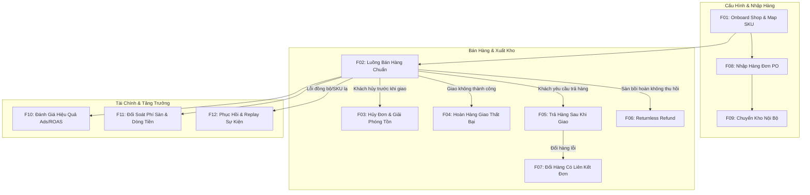

# NOXUS — Bản Đồ Quy Trình Đầu Cuối Đa Sàn (End-to-End Flow Map)

**Ngày ban hành:** 30/10/2026 (Asia/Ho_Chi_Minh)  
**Baseline Git Commit:** `b891421eecf1efb6670af93912a04b2a7154a766`  
**Refactor Branch:** `refactor/prototype-marketplace-e2e`  
**Mục tiêu:** Mô tả chi tiết 12 luồng nghiệp vụ cốt lõi (F01 — F12), xác định rõ tác nhân (actors), điều kiện kích hoạt, chuyển đổi trạng thái và nguồn chân lý (Source of Truth).

---

## 1. Danh Sách 12 Luồng Nghiệp Vụ Cốt Lõi

---

## 2. Chi Tiết Từng Luồng Nghiệp Vụ

### F01: Kết Nối Gian Hàng & Khớp Mã SKU (Onboard Shop & SKU Mapping)
- **Tác nhân:** `Admin` (cấu hình kết nối), `Manager` (thiết lập liên kết SKU), `Owner` (giám sát).
- **Kích hoạt:** Gian hàng mới được thêm vào từ TikTok Shop, Shopee, hoặc Lazada.
- **Quy trình:**
  1. `Admin` tạo bản ghi Mock Connector trong `channelConnections` với thông số: Platform, Shop Name, Shop ID, Mock Webhook URL.
  2. `Manager` vào `ChannelMappingPage` để liên kết SKU sàn (External SKU) với SKU nội bộ (Master SKU trong kho).
  3. Hệ thống kiểm tra ràng buộc duy nhất; cấm map nhiều SKU nội bộ mâu thuẫn vào cùng một mã hàng ngoại sàn.
- **Nguồn chân lý (Source of Truth):** `channel_sku_mappings` và `channel_connections`.

---

### F02: Đơn Hàng Chuẩn Bán Qua Sàn (Standard Marketplace Sale)
- **Tác nhân:** Sàn thương mại điện tử (External), `Manager` (điều phối), `Warehouse` (nhặt & đóng gói).
- **Quy trình & Chuyển đổi trạng thái:**
  1. **Nhận đơn sàn:** Webhook gửi sự kiện `order_created`. Hệ thống kiểm tra trùng lặp `(tenant_id, shop_id, channel_order_sn)`.
  2. **Khóa tồn kho (Reserve):** `inventory5State.reserved += qty`, `inventory5State.available -= qty`. Tồn vật lý `physical` giữ nguyên không đổi.
  3. **Tạo đợt gom hàng (Wave Picking):** `Manager` hoặc `Warehouse` tạo wave gom các đơn có cùng hạn giao (SLA).
  4. **Nhặt hàng & Đóng gói:** `Warehouse` quét mã SKU/serial, in phiếu nhặt hàng (Pick List) và tem vận đơn sàn.
  5. **Bàn giao bưu tá (Handover/Dispatch):** `Warehouse` bấm "Đóng gói & Xuất kho". Hệ thống thực hiện:
     - `inventory5State.physical -= qty`
     - `inventory5State.reserved -= qty`
     - Ghi nhận `stockLedger` loại `OUT_SALE` với giá vốn snapshot (Unit Cost MAC).
     - Trạng thái đơn chuyển sang: `status: 'shipped'`, `fulfillment_status: 'dispatched'`, `delivery_status: 'in_transit'`.
  6. **Giao hàng thành công (POD):** Sự kiện webhook từ đơn vị vận chuyển xác nhận bưu tá đã giao.
     - `status: 'delivered'`, `delivery_status: 'delivered'`, `revenue_recognized: true`.
     - Vai trò `warehouse` **không có quyền** bấm giao hàng thành công trên màn hình thao tác thường ngày.
- **Bất biến số liệu:** `Physical = Available + Reserved + Unavailable`. Bước nhặt hàng không trừ physical; chỉ khi bàn giao bưu tá mới giảm physical và reserved đồng thời.

---

### F03: Hủy Đơn Hàng Trước Khi Bàn Giao (Cancellation Before Handover)
- **Tác nhân:** Khách hàng trên sàn / Seller Center / `Manager`.
- **Kích hoạt:** Yêu cầu hủy đơn được gửi khi đơn đang ở trạng thái `pending` hoặc `processing` (chưa xuất kho).
- **Quy trình:**
  1. `Manager` kiểm tra và chấp thuận yêu cầu hủy đơn.
  2. Hệ thống giải phóng số lượng tồn kho đã khóa:
     - `inventory5State.reserved -= qty`
     - `inventory5State.available += qty`
     - Tồn vật lý `physical` không thay đổi.
  3. Đơn hàng chuyển sang `status: 'cancelled'`. Toàn bộ chi phí nhặt hàng (nếu đã nhặt) được giữ nguyên, nhưng giá vốn hàng bán COGS được đảo về 0.
- **Nguồn chân lý:** `orders.status = 'cancelled'`, `order_status_log`.

---

### F04: Hoàn Hàng Giao Không Thành Công (Failed Delivery & Return)
- **Tác nhân:** Đơn vị vận chuyển (Carrier), `Warehouse` (thủ kho nhận & QC).
- **Quy trình 2 Bước Nghiêm Ngặt:**
  1. **Bước 1 — Tiếp nhận kiện hàng tại cửa kho (Dock Receipt):**
     - Khi bưu tá mang kiện hàng không giao được quay lại kho, nhân viên kho quét mã vận đơn trên `ReturnsPage`.
     - Tồn vật lý tăng vào nhóm chờ kiểm tra: `physical += qty`, `unavailable += qty`, `pending_qc += qty`.
     - **Tồn khả dụng bán (`available`) tuyệt đối không tăng ở bước này.**
  2. **Bước 2 — Kiểm tra tình trạng sản phẩm (QC Inspection):**
     - Thủ kho mở kiện hàng kiểm tra tem mác, phụ kiện, tình trạng nguyên vẹn.
     - **Nếu Đạt (Good Condition):** Chuyển từ chờ kiểm sang bán được:
       - `pending_qc -= qty`, `unavailable -= qty`
       - `available += qty`, `sellable += qty`
       - Tồn vật lý `physical` giữ nguyên (không bị cộng dồn lần 2).
       - Ghi sổ kho `stockLedger`: `RETURN_RESTOCK_SELLABLE`.
     - **Nếu Hỏng (Damaged / Scrap):** Chuyển sang tồn hư hỏng:
       - `pending_qc -= qty`
       - `damaged += qty`
       - Tồn khả dụng `available` không đổi. Ghi sổ kho tổn thất.
- **Bất biến:** Chống cộng lặp khi thủ kho quét hai lần cùng một mã kiện hoàn.

---

### F05: Khách Hàng Trả Hàng & Hoàn Tiền (Customer Return & Refund)
- **Tác nhân:** Khách hàng, Sàn thương mại điện tử, `Manager`, `Warehouse`.
- **Quy trình:**
  1. Sàn thông báo yêu cầu trả hàng từ người mua (do sai sản phẩm, lỗi, đổi ý).
  2. `Manager` theo dõi tiến độ gửi hàng của khách trên sàn.
  3. Khi hàng thực tế về đến kho: Áp dụng quy trình nhận tại dock và kiểm tra QC giống F04.
  4. Sàn hoàn tất chuyển tiền hoàn cho khách (`payment_status: 'refunded'`).
  5. Hệ thống ghi nhận chi phí vận chuyển chiều về (nếu shop phải chịu) và giảm trừ doanh thu giữ lại.

---

### F06: Hoàn Tiền Không Thu Hồi Hàng (Returnless Refund)
- **Tác nhân:** Sàn thương mại điện tử (chính sách đền bù/trợ giá), `Manager`.
- **Đặc điểm:** Sàn đồng ý hoàn tiền cho khách hàng vì giá trị món hàng thấp hoặc thời gian vận chuyển quá lâu mà không yêu cầu khách gửi trả lại sản phẩm.
- **Quy tắc hệ thống:**
  - Cập nhật doanh thu thuần bị giảm trừ (`payment_status: 'refunded'`).
  - **Tuyệt đối không sinh phiếu nhập kho ảo, không tăng tồn vật lý lẫn tồn khả dụng.**
  - Giữ nguyên giá vốn COGS là chi phí tổn thất hàng hóa đã xuất.

---

### F07: Đổi Hàng Có Liên Kết Đơn (Replacement Exchange)
- **Tác nhân:** `Manager`, `Warehouse`.
- **Quy trình:**
  1. Hàng hoàn về kho được kiểm tra QC xác nhận lỗi kỹ thuật do nhà sản xuất.
  2. Thay vì kết thúc bằng hoàn tiền giả định, `ReturnsPage` khởi tạo đơn hàng thay thế (`replacement_order_id`) liên kết trực tiếp với đơn ban đầu.
  3. Đơn thay thế thực hiện khóa tồn, xuất kho và in vận đơn như một đơn hàng mới nhưng giá trị thanh toán bằng 0 ₫ (bảo hành/đổi trả).

---

### F08: Bổ Sung Tồn Kho Qua Đơn Mua Hàng (Purchase Order Replenish)
- **Tác nhân:** `Owner`/`Manager` (tạo & duyệt PO), `Warehouse` (nhận hàng thực tế).
- **Quy trình:**
  1. `Owner` tạo đơn mua hàng PO với nhà cung cấp, ghi nhận số lượng đặt và đơn giá nhập dự kiến. Trạng thái: `draft`.
  2. Phê duyệt PO: Trạng thái chuyển sang `ordered`.
  3. Hàng về kho: `Warehouse` bấm "Nhận Hàng Vào Kho (Receive Stock)" trên `PurchaseOrdersPage`.
  4. Hệ thống cập nhật:
     - `purchase_order_items.received_qty += received`
     - `inventory5State.physical += received`
     - `inventory5State.available += received`
     - `inventory5State.sellable = available`
     - Cập nhật giá vốn bình quân di động (Moving Average Cost - MAC) cho sản phẩm.
     - Trạng thái PO: `partial` (nếu nhận một phần) hoặc `received` (nếu nhận đủ).

---

### F09: Điều Chuyển Tồn Kho Giữa Các Chi Nhánh (Stock Transfer)
- **Tác nhân:** `Manager` (đề xuất điều phối), `Warehouse A` (xuất), `Warehouse B` (nhập).
- **Quy trình:**
  1. `Manager` tạo phiếu chuyển kho `stock_transfers` từ Kho Tổng Miền Bắc sang Kho Miền Trung.
  2. **Xuất kho:** `Warehouse A` đóng hàng và chuyển sang `in_transit`:
     - Kho A: `physical -= qty`, `available -= qty`.
     - Tồn đang chuyển: `in_transit += qty`.
  3. **Nhận kho:** `Warehouse B` kiểm đếm thực tế và bấm xác nhận nhận hàng:
     - Tồn đang chuyển: `in_transit -= qty`.
     - Kho B: `physical += received_qty`.
  4. Nếu có hao hụt hư hỏng dọc đường: Ghi nhận chênh lệch vào `damaged` của Kho B; không làm biến mất số liệu khỏi hệ thống.

---

### F10: Phân Tích & Đối Soát Chiến Dịch Ads (Ads Performance Review)
- **Tác nhân:** `Growth` (chuyên viên tăng trưởng), `Owner` (duyệt ngân sách).
- **Quy trình tính toán:**
  1. `Growth` chọn kênh bán (TikTok Shop, Shopee, Lazada) và khoảng thời gian.
  2. Hệ thống tổng hợp:
     - **Reported Revenue (Doanh thu sàn báo cáo):** Tổng doanh thu các đơn hàng phát sinh gắn mã chiến dịch.
     - **Adjusted Revenue (Doanh thu thực tế giữ lại):** Loại trừ các đơn hủy trước bàn giao và đơn hoàn tiền.
     - **Net Ad Spend:** Chi phí quảng cáo thực chịu trừ đi các khoản hoàn phí Ads (nếu sàn bồi hoàn).
     - **ROAS Điều chỉnh:** `Adjusted Revenue / Net Ad Spend`. Mẫu số bằng 0 hiển thị N/A, không sinh lỗi `Infinity` hay `NaN`.
  3. Toàn bộ chỉ số được gán nhãn dữ liệu `attributionType = 'ESTIMATED'` minh bạch, không giả danh số liệu xác thực cấp giao dịch ngân hàng.

---

### F11: Đối Soát Phí Sàn & Quyết Toán (Marketplace Fee Reconciliation)
- **Tác nhân:** `Manager` (được cấp scope reconcile), `Owner`.
- **Quy trình:**
  1. Nhập bảng kê quyết toán định kỳ từ Seller Center (Shopee Settlement, TikTok Payout).
  2. Khớp mã đơn `order_id` với các bản ghi `order_fee_breakdowns`:
     - Phí hoa hồng sàn (Commission Fee).
     - Phí thanh toán (Payment / Transaction Fee).
     - Phí đồng tài trợ Voucher (Voucher Co-fund).
     - Chênh lệch phí vận chuyển thực tế vs dự tính (Shipping Weight Discrepancy).
  3. `Manager` kiểm tra và bấm "Xác nhận đối soát". Bản ghi được lưu bền vững: `is_reconciled: true`.

---

### F12: Phục Hồi & Xử Lý Sự Kiện Ngoại Lệ (Exception Recovery & Idempotency)
- **Tác nhân:** `Admin` (chẩn đoán kỹ thuật), `Manager`.
- **Tình huống xử lý:**
  1. **SKU chưa map:** Đơn hàng có SKU lạ được đưa vào hàng đợi giữ hàng (Quarantine Queue), không tự động gán nhầm vào SKU khác. Sau khi map xong, hỗ trợ replay sự kiện một lần duy nhất.
  2. **Sự kiện gửi chậm / gửi ngược thứ tự:** Sự kiện `shipped` đến sau khi đơn đã `delivered` sẽ bị hệ thống bỏ qua, không được phép kéo lùi trạng thái đơn hàng.
  3. **Duplicate Webhook:** Webhook gửi lặp lại cùng một mã giao dịch được nhận diện qua khóa idempotent và phản hồi thành công mà không trừ tồn kho lần hai.
