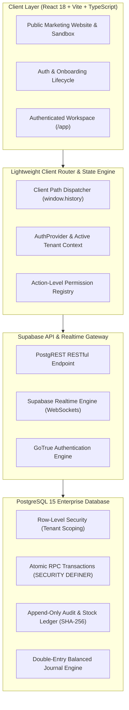
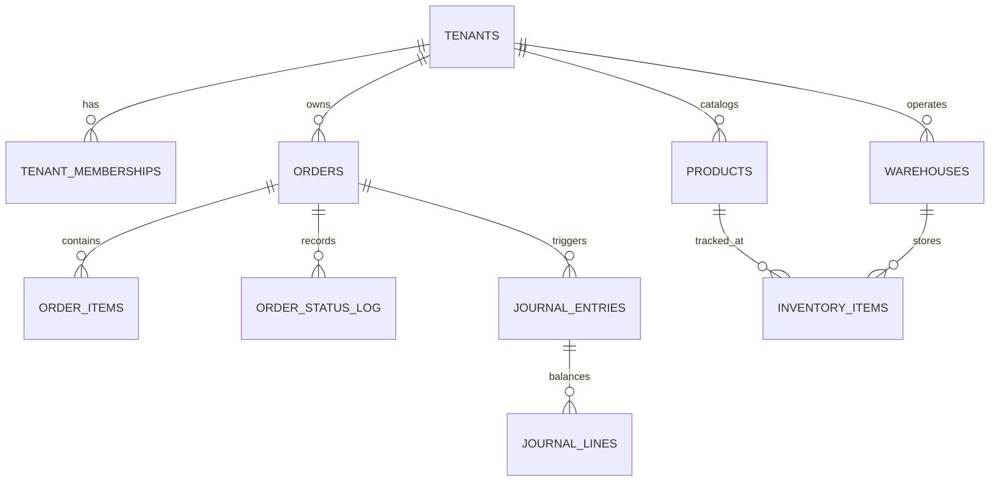

# 2. NEXUSOMS V5 SYSTEM ARCHITECTURE SPECIFICATION

## 1. High-Level System Architecture

NexusOMS V5 operates as a modern cloud-native, distributed multi-tenant Order Management and Warehouse Management platform.



---

## 2. Core Architectural Principles

### 2.1 Database-Level Multi-Tenancy (Row-Level Security)
Every business table contains a `tenant_id uuid NOT NULL REFERENCES public.tenants(id) ON DELETE RESTRICT cascades`.
RLS policies guarantee that all queries, inserts, updates, and deletes are scoped strictly to the calling user's active tenant memberships:

```sql
CREATE POLICY tenant_isolation_policy ON public.orders
FOR ALL TO authenticated
USING (tenant_id IN (
  SELECT tenant_id FROM public.tenant_memberships 
  WHERE user_id = auth.uid() AND status = 'active'
))
WITH CHECK (tenant_id IN (
  SELECT tenant_id FROM public.tenant_memberships 
  WHERE user_id = auth.uid() AND status = 'active'
));
```

### 2.2 Atomic Server-Side Transactions
All state mutations affecting physical goods or financial journals bypass client REST mutations and execute via `SECURITY DEFINER` stored procedures:
- `place_order_atomic(p_tenant_id, p_customer_id, p_channel, p_items, p_idempotency_key, ...)`
- `cancel_order_atomic(p_tenant_id, p_order_id, p_reason)`
- `delete_order_atomic(p_tenant_id, p_order_id)`
- `process_return_restock_atomic(p_tenant_id, p_return_id, p_restock_items)`
- `post_journal_entry_atomic(p_tenant_id, p_entry_number, p_event_source, p_lines, ...)`
- `verify_inventory_consistency(p_tenant_id)`

---

## 3. Data Tier Schema Overview



---

## 4. State Machine & Lifecycle Transitions

### 4.1 Order State Machine
`pending` → `processing` (Stock Reserved) → `picking` → `packing` → `shipped` (Physical Decremented) → `delivered` → `completed` (Journal Posted).
Alternative terminal paths: `cancelled` (Stock Restored via Atomic RPC) or `returned` (RMA Inspection).

### 4.2 Financial Accounting State Machine
All accounting events trigger a balanced entry in `journal_entries` and `journal_lines`. The constraint requires:
$$\sum \text{Debit} = \sum \text{Credit}$$
Deviation $> 0.001$ raises SQLSTATE `23514` (check violation).
