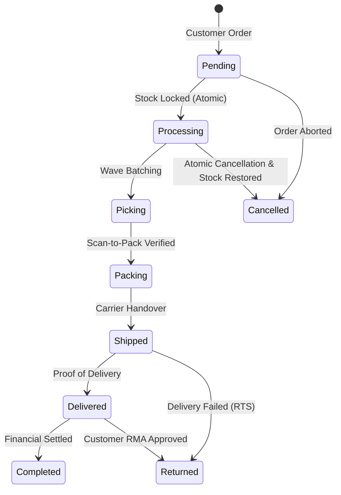

# 4. BUSINESS RULES SPECIFICATION — NEXUSOMS ENTERPRISE

## 1. Foundational Invariants

### Rule 1: Zero Negative Stock Invariant (BR-INV-001)
At no point may `available_qty` or `physical_qty` of any product or warehouse inventory record drop below zero.
- **Enforcement:** Enforced at the schema level via `products_stock_non_negative` and verified at runtime via `verify_inventory_consistency`.

### Rule 2: Atomic Reservation Invariant (BR-INV-002)
Inventory reservation for multi-item orders must execute in a single ACID transaction. If any individual item cannot be fulfilled from available inventory, the entire order transaction is rolled back. No partial order states are persisted.

### Rule 3: Single Restock Guarantee (BR-INV-003)
Stock released from a cancelled, deleted, or returned order may only be restored to available stock once. The flag `orders.stock_restored` transitions from `false` to `true` and may never transition back.

### Rule 4: Balanced Journal Invariant (BR-FIN-001)
Every financial journal entry posted to the general ledger must satisfy:
$$\sum_{i=1}^n \text{debit}_i = \sum_{j=1}^m \text{credit}_j$$
Any transaction with $|\sum \text{debit} - \sum \text{credit}| > 0.001$ must be aborted by PostgreSQL error code `23514`.

### Rule 5: Strict Multi-Tenant Isolation (BR-SEC-001)
No query, mutation, or stored procedure may execute without an explicit `tenant_id` validated against the caller's active membership in `tenant_memberships`. Users without active membership receive zero records via Row-Level Security.

### Rule 6: Owner Protection Rule (BR-RBAC-001)
The final active `owner` of an organization may not be demoted, suspended, or deleted. Any administrative action that would leave an organization without an active owner is blocked by trigger `prevent_last_owner_demotion`.

---

## 2. Order Fulfillment Business Rules

