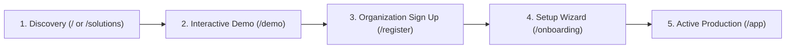

# 13. END-TO-END CUSTOMER JOURNEY SPECIFICATION

## 1. Persona Mapping
NexusOMS V5 supports three distinct user journeys:
1. **Prospective Enterprise Client:** Discovers NexusOMS, explores technical architecture and sandbox demo, evaluates pricing plans, and requests consultation.
2. **New Business Owner:** Registers company, runs the 6-step Onboarding Wizard, connects marketplace channels, and invites the operations team.
3. **Daily Warehouse & Operations Operator:** Logs into active workspace, manages waves, scans barcodes, processes returns, and monitors daily inventory levels.

---

## 2. Journey Stages & Conversion Funnel

### Stage 1: Discovery & Technical Credibility
Visitors land on `/` or industry-specific solution pages. Value proposition badges highlight ACID transactions, sub-15ms stock lock, and double-entry accounting.

### Stage 2: Sandbox Exploration
Visitors can interact with the in-memory simulator at `/demo` without registering or providing credit cards. They experience live order simulations, stock deductions, and ledger generation in a risk-free environment.

### Stage 3: Self-Service Registration & Onboarding
Users sign up at `/register`. The system records organization name and routes immediately to the interactive 6-step setup wizard, creating default warehouses and seeding sample SKUs.

### Stage 4: Production Work
The authenticated user enters `/app` with their tenant context loaded, ready for real-world multichannel sales operations.
