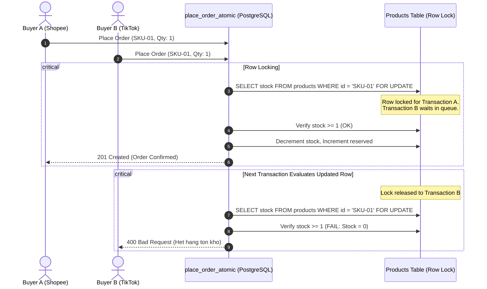

# 8. INVENTORY INTEGRITY & ATOMIC STOCK LOCK REPORT

## 1. 5-State Inventory Model
NexusOMS V5 models inventory using five precise physical and commercial states:
1. **Physical Stock (`physical_qty`):** Quantity physically located on warehouse shelves and bins.
2. **Reserved Stock (`reserved_qty`):** Quantity committed to active, unfulfilled customer orders.
3. **Available Stock (`available_qty`):** Saleable quantity pushed to e-commerce channels:
   $$\text{Available} = \text{Physical} - \text{Reserved}$$
4. **Unavailable Stock (`unavailable_qty`):** Defective, expired, quarantined, or damaged goods.
5. **Incoming Stock (`incoming_qty`):** Purchase orders in transit scheduled for receipt.

---

## 2. Race Condition Prevention via Atomic Locking

---

## 3. Inventory Verification Tooling
Integrated in V5 at **Tồn kho 5 trạng thái** via stored procedure `verify_inventory_consistency(p_tenant_id)`.
Scans for:
- Negative stock (`stock < 0` or `available_qty < 0`).
- Discrepancy between `physical_qty` and `reserved_qty + available_qty`.
- Inconsistencies between product master stock and sum of warehouse balances.
