# KIẾN TRÚC ĐỘC LẬP DATA ANALYTICS & UNIT ECONOMICS ENGINE V6 (ANALYTICS ARCHITECTURE)

## 1. Tổng Quan Kiến Trúc
Analytics Engine của NexusOMS V6 được thiết kế hoàn toàn bằng **TypeScript thuần**, độc lập và phân lớp rõ ràng.
Engine tuân thủ nguyên tắc **Single Source of Truth (SSOT)**: Mọi báo cáo từ Dashboard, Unit Economics đến Inventory Analytics đều tổng hợp trực tiếp từ cùng một kho dữ liệu trung tâm (`Centralized Mock Store`), tuyệt đối không hardcode KPI cục bộ trên từng component.

```mermaid
graph TD
    subgraph DataStoreLayer ["1. Lớp Lưu Trữ Dữ Liệu Trung Tâm"]
        MockStore["Centralized Mock Data Store (In-Memory + LocalStorage)"]
        Orders["orders & orderItems"]
        Products["products & prices & cogs"]
        Inventory["inventory5State (Canonical Invariant)"]
        Customers["customers & rfmHistory"]
        Settlements["marketplaceReconciliations"]
        
        MockStore --> Orders
        MockStore --> Products
        MockStore --> Inventory
        MockStore --> Customers
        MockStore --> Settlements
    end

    subgraph DomainModelLayer ["2. Lớp Mô Hình & Chiều Dữ Liệu (src/analytics/types.ts)"]
        Dimensions["DateDimensions, Channels, SKU, Tenants, Warehouses"]
        AttributionType["DataAttributionType: ACTUAL | ESTIMATED | ASSUMPTION | SIMULATED"]
        EconModels["OrderUnitEconomics, SkuUnitEconomics, ChannelUnitEconomics"]
    end

    subgraph MetricsEngineLayer ["3. Lớp Tính Toán & Công Thức Chuẩn (src/analytics/metricsEngine.ts)"]
        SafeMath["safeDivide() (Zero & NaN Guard) & calculatePercentDelta()"]
        CMFormulas["calculateOrderContribution() (CM1, CM2, CM3)"]
        PricingSim["simulatePricing() (Break-even, Target, Max Discount)"]
    end

    subgraph AnalyticsServiceLayer ["4. Lớp Dịch Vụ Tổng Hợp (src/analytics/analyticsService.ts)"]
        AggExecutive["getExecutiveDashboardData() (Waterfall, KPIs, Insights)"]
        AggSKU["getSkuEconomics() (ASP, COGS, Stock ROI, DIO, ABC/XYZ)"]
        AggChannel["getChannelEconomics() (Take rate, ROAS, Margins)"]
        AggCohorts["getCustomerAnalytics() (Retention Matrix, RFM)"]
        AggOperations["getOperationsPerformance() (Cycle Time, SLA)"]
        AggCapital["getWorkingCapitalOverview() (CCC, Working Capital Gap)"]
    end

    subgraph ChartSystemLayer ["5. Lớp Trực Quan Hóa (src/components/charts/)"]
        RechartsWrapper["LineAreaChart, GroupedBarChart, ParetoChart, ScatterBubbleChart"]
        CustomVisuals["WaterfallChart, HeatmapChart, CohortHeatmap, PricingSimulator"]
        AtomicCards["KPICard, AnalyticsCard, DateRangeFilter, InsightSummary"]
    end

    subgraph PresentationLayer ["6. Lớp Màn Hình Người Dùng (src/pages/)"]
        Screens["Executive Dashboard, Order Economics, SKU Economics, Pricing Intelligence..."]
    end

    DataStoreLayer --> DomainModelLayer
    DomainModelLayer --> MetricsEngineLayer
    MetricsEngineLayer --> AnalyticsServiceLayer
    AnalyticsServiceLayer --> ChartSystemLayer
    ChartSystemLayer --> PresentationLayer
```



---

## 2. Phân Tách Bốn Cấp Độ Dữ Liệu (Data Attribution Tiers)

Để đảm bảo tính trung thực và ngăn chặn việc ngụy tạo độ chính xác giả tạo, toàn bộ số liệu trong V6 đều được gắn cờ thuộc tính:
1. **`ACTUAL` (Thực tế quan sát được):**
   - Số liệu ghi nhận trực tiếp từ đơn hàng, giao dịch kho, hóa đơn hoặc đối soát:
   - *Ví dụ:* Doanh thu thuần, Giá vốn đích danh (COGS), Phí hoa hồng sàn Shopee/TikTok đã trừ trên đơn, Tồn kho vật lý.
2. **`ESTIMATED` (Ước tính theo mô hình phân bổ):**
   - Số liệu tính toán dựa trên mô hình phân bổ thống kê:
   - *Ví dụ:* Phân bổ chi phí quảng cáo (Blended CAC), Chi phí đóng gói và nhân công kho trung bình cho mỗi đơn, Giá trị vòng đời khách hàng (Estimated LTV).
3. **`ASSUMPTION` (Giả định kinh doanh):**
   - Các tham số hoặc quy tắc kế toán chưa có dữ liệu đối soát thực tế:
   - *Ví dụ:* Tỷ lệ chiết khấu cố định định kỳ, Thời điểm ghi nhận doanh thu (FOB Destination vs Shipping Point), Chi phí thuê kho và phần mềm phân bổ cho từng đơn hàng.
4. **`SIMULATED` (Mô phỏng thử nghiệm):**
   - Dữ liệu do người dùng thay đổi trên các thanh trượt kịch bản:
   - *Ví dụ:* Kết quả chạy What-if trên công cụ Pricing Intelligence khi thử thay đổi giá niêm yết hoặc tỷ lệ voucher.

---

## 3. Khử Triệt Để Lỗi Tính Toán & NaN/Infinity Guard

Trong toàn bộ Engine, mọi phép chia và tăng trưởng đều đi qua hàm kiểm định:
```typescript
export function safeDivide(numerator: number, denominator: number, fallback = 0): number {
  if (!denominator || isNaN(denominator) || denominator === 0 || !isFinite(numerator) || !isFinite(denominator)) {
    return fallback;
  }
  const result = numerator / denominator;
  return isFinite(result) ? result : fallback;
}
```
- **Kỳ trước bằng 0:** Khi so sánh tăng trưởng mà mẫu số bằng 0, hệ thống tự động trả về `100%` (hoặc nhãn `Mới / N/A`), tuyệt đối không hiển thị `Infinity%` hoặc `NaN`.
- **Dữ liệu thiếu:** Hiển thị dấu gạch ngang `—` hoặc trạng thái rỗng thân thiện (Empty State), giải thích rõ nguyên nhân thay vì hiển thị số 0 ngụy tạo.

---

## 4. Quản Lý Độc Lập Giữa Dòng Tiền & Kế Toán Dồn Tích

- **Bảo toàn ranh giới:** Tuyệt đối không nhầm lẫn giữa **Dòng tiền thực thu (Cash Basis)** và **Lợi nhuận đóng góp (Accrual Contribution Margin)**.
- **Tránh trùng lặp chi phí:** Trong chuỗi bóc tách P&L, chi phí đã trừ ở tầng trước (như Phí sàn ở CM2) không bao giờ bị trừ lại ở tầng sau (như CM3 hay Net Profit).
