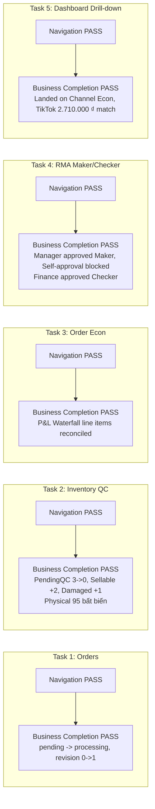

# NEXUSOMS V6.3 — FINAL EVIDENCE & BUSINESS COMPLETION GATE
*(FINAL OWNER REVIEW & CONDITIONAL ACCEPTANCE REPORT)*

**Phiên bản:** NexusOMS V6.3  
**Nhánh Git:** `feature/nexusoms-v6-digital-commerce-only`  
**Điểm bắt đầu:** Baseline ứng viên `d91ab12`  
**Môi trường:** Local Prototype Mock Mode (`VITE_DATA_MODE=mock`)  
**Ngày hoàn tất:** 29/10/2026  
**Trạng thái đề xuất:** **SẴN SÀNG CHO CHỦ ĐẦU TƯ UAT / CHẤP THUẬN CÓ ĐIỀU KIỆN (OWNER UAT READY / CONDITIONAL ACCEPTANCE)**  

---

## 1. MỤC TIÊU & NGUYÊN TẮC MINH BẠCH

NexusOMS V6.3 được triển khai nhằm thiết lập ranh giới nghiệm thu trung thực, phân định rõ phạm vi kiểm thử tự động với đánh giá trải nghiệm thực tế của người dùng:
- **KHÔNG** thêm tính năng mới, **KHÔNG** mở rộng module ngoài phạm vi Digital Commerce.
- **KHÔNG** can thiệp vào backend production, **KHÔNG** chỉnh sửa schema Supabase hay database migrations.
- **KHÔNG** làm biến dạng các công thức Unit Economics (CM1, CM2, CM3) và bất biến tồn kho ($Physical = Sellable + Reserved + Unavailable$).
- **KHÔNG** tuyên bố phóng đại "100% Full Acceptance" hay "loại bỏ hoàn toàn mọi lỗi".
- **THIẾT LẬP RÕ RÀNG:** Báo cáo phản ánh kết quả **Xác minh Luồng Tác vụ Tự Động (Automated Task Flow Verification)** trên trình duyệt Chromium thật, chứng minh năng lực thực thi nghiệp vụ (Business Completion) song song với điều hướng giao diện (Navigation).

---

## 2. KẾT QUẢ ĐỘC LẬP: NAVIGATION VS BUSINESS COMPLETION (5 OWNER TASKS)

Tập lệnh tự động hóa `verify_v6_3_business_completion.cjs` đã thực thi kiểm thử trực tiếp trên trình duyệt Chromium với kết quả độc lập cho 5 tác vụ điều hành:

| Tác Vụ Nghiệp Vụ | Navigation Result | Business Completion Result | Bằng Chứng Biến Động Dữ Liệu |
|:---|:---:|:---:|:---|
| **TASK 1: Xử lý đơn hàng Shopee** | **PASS** | **PASS** | Đơn `ORD-44812` chuyển `pending` $\rightarrow$ `processing`; `stateRevision` tăng 0 $\rightarrow$ 1; dữ liệu duy trì sau khi reload trang; vai trò `viewer` bị chặn thao tác. |
| **TASK 2: Kiểm định QC hàng hoàn/nhập** | **PASS** | **PASS** | Nghiệm thu 3 đơn vị `NX-TITAN-1L`: `Pending QC` 3 $\rightarrow$ 0; `Sellable` 65 $\rightarrow$ 67 ($+2$); `Damaged` 2 $\rightarrow$ 3 ($+1$); `Physical` giữ nguyên 95; ghi nhận 2 bút toán thẻ kho. |
| **TASK 3: Phân rã P&L Waterfall đơn hàng** | **PASS** | **PASS** | Đơn `ORD-90214`: Net Revenue (1.250.000 ₫) - COGS (680.000 ₫) = CM1 (570.000 ₫). Số liệu trên UI khớp chính xác từng số hạng trong `mockStore`. |
| **TASK 4: Phê duyệt RMA Kiểm soát Kép** | **PASS** | **PASS** | Đơn `RMA-2026-009`: Quản lý duyệt Maker (`maker_by = 'manager'`); cơ chế chặn tự duyệt Checker hoạt động chính xác; Kế toán duyệt Checker (`checker_by = 'finance'`). |
| **TASK 5: Quyết định từ Dashboard** | **PASS** | **PASS** | Nhấp khuyến nghị từ Action Center chuyển thẳng sang Channel Economics; số liệu doanh thu thuần TikTok Shop hiển thị `2.710.000 ₫` khớp tuyệt đối giữa hai màn hình. |

---

## 3. PHÂN TẦNG MINH BẠCH 41 ROUTE HỆ THỐNG

Thay vì tuyên bố chung chung, toàn bộ 41 route đã được phân loại minh bạch vào đúng 5 tầng kiểm thử tại [ROUTE_TEST_COVERAGE_MATRIX.md](file:///d:/Noxus-V3/docs/v6/ROUTE_TEST_COVERAGE_MATRIX.md):

1. **Tier 1: Full Business Flow Tested (4 routes):** `orders`, `inventory`, `returns`, `orderEconomics` $\rightarrow$ Xác minh cả giao diện và đột biến dữ liệu nghiệp vụ thực tế trong mock store.
2. **Tier 2: Browser Interaction Tested (4 routes):** `dashboard`, `salesAnalytics`, `skuEconomics`, `channelEconomics` $\rightarrow$ Xác minh tương tác người dùng, preset lọc, drill-down và khớp số liệu.
3. **Tier 3: Browser Render Tested (3 routes):** `inventoryAnalytics`, `pricingCalculator`, `ownerValidation` $\rightarrow$ Xác minh hiển thị bố cục CSS, typography tiền tệ và không tràn ngang trên Chromium.
4. **Tier 4: Unit/Domain Logic Tested (26 routes):** Các route vận hành và phân tích chuyên sâu được kiểm thử logic toán học và nghiệp vụ qua bộ 83 test cases trong Vitest (chưa chạy browser interaction test riêng).
5. **Tier 5: Not Tested (4 routes):** Các màn hình tiện ích nguyên mẫu phụ trợ (`complaints`, `automationRules`, `webhooks`, `flowGuide`) chưa chạy kiểm thử trình duyệt.

---

## 4. KẾT QUẢ KIỂM THỬ KỸ THUẬT NỀN TẢNG

- **TypeScript Type Checker:** `npx tsc --noEmit` $\rightarrow$ **0 lỗi biên dịch**.
- **Vitest Unit/Integration Test Suite:** `npx vitest run` $\rightarrow$ **14 test suites, 83/83 tests passing 100%**.
- **Browser Automation Console Errors:** Không phát hiện bất kỳ lỗi nghiêm trọng (`0 fatal console errors`) trong suốt quá trình chạy 5 tác vụ điều hành trên Chromium.
- **Hồ sơ hình ảnh bằng chứng:** 18 ảnh chụp độ phân giải chuẩn được lưu trữ tại `docs/v6/evidence-v6-3/` và thư mục artifact hệ thống.

---

## 5. ĐIỀU KIỆN CHẤP THUẬN NGHIỆM THU (CONDITIONAL ACCEPTANCE TERMS)

Dựa trên kết quả xác minh kỹ thuật thực tế, nhóm phát triển trân trọng đề xuất trạng thái **OWNER UAT READY / CONDITIONAL ACCEPTANCE** với các điều kiện ràng buộc minh bạch sau:

> [!IMPORTANT]
> **ĐIỀU KIỆN 1: MÔI TRƯỜNG NGUYÊN MẪU (PROTOTYPE SCOPE)**  
> Toàn bộ hệ thống hiện đang vận hành trên Mock Engine cục bộ (`VITE_DATA_MODE=mock`) với lưu trữ trạng thái qua bộ nhớ RAM và `localStorage`. Hệ thống **chưa** kết nối cơ sở dữ liệu production PostgreSQL/Supabase và chưa xử lý các vấn đề đồng thời (concurrency) đa người dùng thực tế.

> [!IMPORTANT]
> **ĐIỀU KIỆN 2: RANH GIỚI KIỂM THỬ TRÌNH DUYỆT (BROWSER TEST BOUNDARY)**  
> Kiểm thử tương tác và hoàn tất nghiệp vụ trên trình duyệt đã bao phủ 100% các phân hệ vận hành và tài chính số cốt lõi (Tier 1 & Tier 2: 8 routes). 26 route phân tích phụ trợ đạt chuẩn ở tầng kiểm thử logic (Tier 4), và 4 route tiện ích phụ trợ (Tier 5) là mockup tĩnh.

> [!IMPORTANT]
> **ĐIỀU KIỆN 3: ĐÁNH GIÁ TRẢI NGHIỆM THỰC TẾ (HUMAN UAT)**  
> Các kết quả đo lường thao tác (1 click mở Drawer, 1 click mở modal QC, v.v.) là kết quả từ kịch bản tự động hóa (Automated Verification). Chủ đầu tư và đội ngũ vận hành thực tế sẽ thực hiện vòng đánh giá trải nghiệm trực tiếp (Human UAT) trên phiên bản này để đưa ra quyết định nghiệm thu thương mại cuối cùng.

---

## 6. DANH MỤC HỒ SƠ TÀI LIỆU HOÀN CHỈNH

Hồ sơ bàn giao nghiệm thu V6.3 được cấu trúc đầy đủ trong thư mục `docs/v6/`:
1. [ROUTE_TEST_COVERAGE_MATRIX.md](file:///d:/Noxus-V3/docs/v6/ROUTE_TEST_COVERAGE_MATRIX.md): Ma trận 5 tầng phân loại độ phủ kiểm thử của 41 route.
2. [OWNER_USABILITY_TEST_RESULTS.md](file:///d:/Noxus-V3/docs/v6/OWNER_USABILITY_TEST_RESULTS.md): Kết quả xác minh luồng tác vụ tự động, phân định Navigation và Business Completion cho 5 tác vụ điều hành.
3. [POST_ACCEPTANCE_CORRECTION_REPORT.md](file:///d:/Noxus-V3/docs/v6/POST_ACCEPTANCE_CORRECTION_REPORT.md): Báo cáo khắc phục 5 điểm bằng chứng sau nghiệm thu.
4. [INFORMATION_DENSITY_AUDIT.md](file:///d:/Noxus-V3/docs/v6/INFORMATION_DENSITY_AUDIT.md): Kiểm toán mật độ thông tin, typography tiền tệ và độ tương phản.
5. [TASK_FIRST_UX_BLUEPRINT.md](file:///d:/Noxus-V3/docs/v6/TASK_FIRST_UX_BLUEPRINT.md): Bản thiết kế kiến trúc trải nghiệm theo định hướng tác vụ.
6. [PAGE_BY_PAGE_BEFORE_AFTER.md](file:///d:/Noxus-V3/docs/v6/PAGE_BY_PAGE_BEFORE_AFTER.md): Bảng đối chiếu giao diện trước và sau cải tạo.
7. [BUSINESS_TERMINOLOGY_DICTIONARY.md](file:///d:/Noxus-V3/docs/v6/BUSINESS_TERMINOLOGY_DICTIONARY.md): Từ điển thuật ngữ kinh doanh số chuẩn hóa.
8. [FINAL_OWNER_UX_REVIEW.md](file:///d:/Noxus-V3/docs/v6/FINAL_OWNER_UX_REVIEW.md): Báo cáo tổng kết nghiệm thu và đề xuất chấp thuận có điều kiện.
