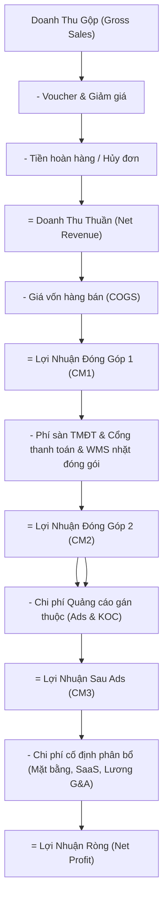

# TỪ ĐIỂN CHỈ SỐ KINH DOANH & KINH TẾ ĐƠN VỊ V6 (METRIC DICTIONARY)

Tài liệu chuẩn hóa toàn bộ các định nghĩa, công thức toán học, tử số / mẫu số, đơn vị đo lường và cách xử lý dữ liệu thiếu trong hệ thống NexusOMS V6.

---

## 1. Nhóm Chỉ Số Doanh Thu & Hiệu Quả Đơn Hàng

### 1.1. Doanh Thu Gộp (Gross Sales)
- **Ý nghĩa kinh doanh:** Tổng giá trị hàng hóa được đặt trước khi trừ bất kỳ voucher, giảm giá hay phí vận chuyển nào.
- **Công thức:**
  $$\text{Gross Sales} = \sum (\text{Unit Price} \times \text{Quantity})$$
- **Đơn vị:** Việt Nam Đồng (₫).
- **Nguồn dữ liệu:** `order.subtotal` hoặc sum(`order_items.unit_price * quantity`).
- **Phân loại thuộc tính:** `ACTUAL`.

### 1.2. Doanh Thu Thuần (Net Revenue)
- **Ý nghĩa kinh doanh:** Doanh thu thực tế của doanh nghiệp sau khi trừ các khoản giảm giá do nhà bán tài trợ và tiền hoàn trả do hủy đơn hoặc trả hàng.
- **Công thức:**
  $$\text{Net Revenue} = \text{Gross Sales} - \text{Seller Discounts} - \text{Refunds/Returns}$$
- **Đơn vị:** Việt Nam Đồng (₫).
- **Phân loại thuộc tính:** `ACTUAL`.

### 1.3. Giá Trị Trung Bình Đơn Hàng (AOV - Average Order Value)
- **Ý nghĩa kinh doanh:** Số tiền trung bình mỗi đơn hàng đóng góp vào doanh thu thuần trong chu kỳ đo lường.
- **Công thức:**
  $$\text{AOV} = \frac{\text{Net Revenue}}{\text{Total Order Count}}$$
- **Xử lý thiếu dữ liệu:** Nếu `Total Order Count = 0`, AOV trả về `0 ₫`.
- **Đơn vị:** Việt Nam Đồng / đơn.

---

## 2. Nhóm 3 Tầng Lợi Nhuận Đóng Góp (Contribution Margins)

### 2.1. Lợi Nhuận Đóng Góp Tầng 1 (CM1 - Gross Contribution Margin)
- **Ý nghĩa kinh doanh:** Lãi gộp sau khi trừ chi phí sản xuất hoặc mua hàng trực tiếp (COGS). Thể hiện sức mạnh định giá và giá thành sản phẩm.
- **Công thức:**
  $$\text{CM1} = \text{Net Revenue} - \text{COGS}$$
  $$\text{CM1 \%} = \frac{\text{CM1}}{\text{Net Revenue}} \times 100\%$$
- **Nguồn dữ liệu:** COGS tính theo giá vốn bình quân di động (`moving_avg_cost`).

### 2.2. Lợi Nhuận Đóng Góp Tầng 2 (CM2 - Operational Contribution Margin)
- **Ý nghĩa kinh doanh:** Lợi nhuận sau khi trừ toàn bộ các chi phí biến đổi phát sinh theo từng đơn hàng: Phí hoa hồng sàn TMĐT, phí thanh toán, chi phí bao bì, tem nhãn, nhân công nhặt hàng và đóng gói kho.
- **Công thức:**
  $$\text{CM2} = \text{CM1} - (\text{Marketplace Fees} + \text{Payment Gateway Fees} + \text{Fulfillment Costs} + \text{Shipping Subsidies})$$
  $$\text{CM2 \%} = \frac{\text{CM2}}{\text{Net Revenue}} \times 100\%$$
- **Ngưỡng an toàn:** CM2 là chỉ tiêu quan trọng nhất trong thương mại điện tử đa kênh. Nếu CM2 < 0, doanh nghiệp đang bị "bán lỗ biến đổi" và càng tăng trưởng số đơn sẽ càng mất tiền.

### 2.3. Lợi Nhuận Đóng Góp Tầng 3 (CM3 - Contribution After Marketing)
- **Ý nghĩa kinh doanh:** Lợi nhuận thực tế còn lại sau khi trừ chi phí Marketing trả phí trực tiếp (Meta Ads, TikTok Ads, Shopee Ads, Booking KOC). Dùng để bù đắp các chi phí cố định (Mặt bằng, khấu hao, lương văn phòng).
- **Công thức:**
  $$\text{CM3} = \text{CM2} - \text{Attributed Marketing Costs}$$
  $$\text{CM3 \%} = \frac{\text{CM3}}{\text{Net Revenue}} \times 100\%$$
- **Phân biệt với Net Profit:** CM3 **KHÔNG PHẢI** là Lợi nhuận ròng cuối cùng của công ty vì chưa trừ các khoản chi phí quản lý doanh nghiệp (G&A), khấu hao thiết bị và thuế TNDN.

---

## 3. Nhóm Chỉ Số Kênh & Quảng Cáo (Marketing & Channels)

### 3.1. Tỷ Lệ Chiết Khấu Sàn (Marketplace Take Rate)
- **Ý nghĩa kinh doanh:** Tỷ lệ % tổng doanh số mà sàn TMĐT (Shopee, TikTok, Lazada) thu của nhà bán (gồm hoa hồng, phí dịch vụ, voucher tài trợ sàn, phí thanh toán).
- **Công thức:**
  $$\text{Take Rate \%} = \frac{\text{Total Marketplace Fees}}{\text{Gross Sales}} \times 100\%$$

### 3.2. Blended ROAS (Return On Ad Spend)
- **Ý nghĩa kinh doanh:** Hiệu quả sinh doanh thu trên mỗi 1 đồng ngân sách quảng cáo.
- **Công thức:**
  $$\text{ROAS} = \frac{\text{Attributed Net Revenue}}{\text{Ad Spend}}$$
- **Đơn vị:** Lần (x).

### 3.3. CPA (Cost Per Acquisition / Order)
- **Công thức:**
  $$\text{CPA} = \frac{\text{Ad Spend}}{\text{Attributed Orders Count}}$$

---

## 4. Nhóm Chỉ Số Tồn Kho & Dòng Tiền (Inventory & Working Capital)

### 4.1. Số Ngày Tồn Kho Bình Quân (DIO - Days Inventory Outstanding)
- **Công thức:**
  $$\text{DIO} = \frac{\text{Average Inventory Value}}{\text{COGS (30 ngày)}} \times 30$$

### 4.2. Chu Kỳ Chuyển Đổi Tiền Mặt (CCC - Cash Conversion Cycle)
- **Ý nghĩa kinh doanh:** Số ngày tính từ khi xuất tiền chi trả cho nhà cung cấp đến khi nhận được tiền thanh toán từ sàn TMĐT về tài khoản ngân hàng.
- **Công thức:**
  $$\text{CCC} = \text{DIO} + \text{DSO} - \text{DPO}$$
  *(Trong đó: DIO = Số ngày tồn kho; DSO = Số ngày công nợ sàn; DPO = Số ngày công nợ nhà cung cấp).*
- **Đơn vị:** Ngày.

### 4.3. Khoảng Cách Vốn Lưu Động (Working Capital Gap)
- **Công thức:**
  $$\text{Working Capital Gap} = (\text{Pending Marketplace Settlements} + \text{Inventory Value}) - \text{Supplier Payables}$$
- **Ý nghĩa:** Cho biết lượng tiền mặt doanh nghiệp cần duy trì để đảm bảo không bị đứt gãy dòng tiền vận hành.
